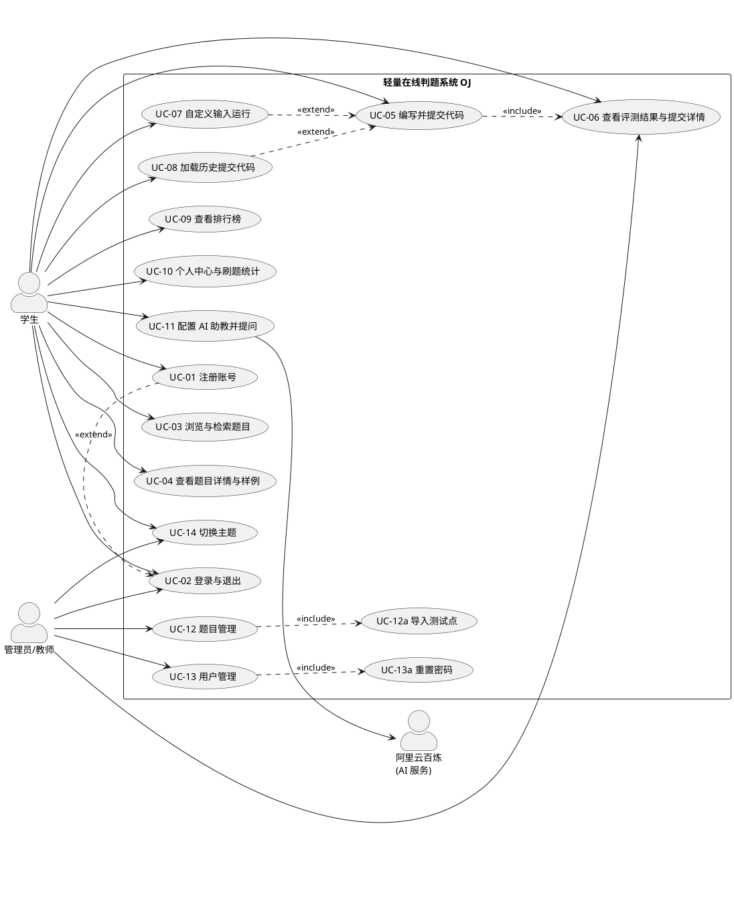

# 轻量在线判题系统（OJ）用例分析

| 项目 | 内容 |
| --- | --- |
| 课程 | 软件工程（6 人小组） |
| 项目 | 轻量在线判题系统 OJ |
| 文档版本 | v1.0 |
| 编制日期 | 2026-11-19 |
| 建模依据 | 《需求工程概述》p34–p44「基于用例的需求建模——建模过程」第 1–6 步，并按本周要求补充第 7 步优先级分析 |
| 关联文档 | `docs/requirements/use-case-specs.md`（详细规格）、`docs/requirements/use-case-diagram.puml`（用例图）、`docs/requirements/backlog.csv`（需求规划清单） |

## 1. 建模过程执行记录

| 步骤 | 课件要点 | 本项目执行结果 | 产出 |
| --- | --- | --- | --- |
| 1. 需求构思 | 澄清项目目标、待解决问题、项目特色；先完成背景理解与需求发掘 | 面向课程教学场景，做一套可本地部署、可演示的轻量 OJ：教师维护题库与测试点，学生在浏览器中写代码、提交、查看逐点结果；特色是 AI 助教与自定义输入自测 | 项目目标与范围（见 1.1） |
| 2. 确定用户分类 | 提取行为者，确定系统边界；角色重叠尽可能少 | 识别出学生、管理员/教师两个人类行为者，以及阿里云百炼 AI 服务这一外部系统行为者；判题沙箱、数据库属于系统内部，不列为行为者 | 行为者表（见第 2 节） |
| 3. 需求调研 | 针对不同用户开展调研 | 调研课程作业流程：学生需要刷题与即时反馈，教师需要录题、配测试点、看通过率；参考主流 OJ 的提交—评测—结果链路 | 用户故事素材（见第 5 节） |
| 4. 拟定用户故事 | 把调研结果写成用户故事；非敏捷方法可跳过；步骤 2–4 需迭代 | 形成 14 条用户故事，按 MoSCoW 标注优先级，作为迭代依据 | 用户故事表（见第 5 节） |
| 5. 用例梳理 | 列出每个行为者使用系统完成的事情；用泛化、包含、扩展处理公共与变更部分 | 梳理出 14 个用例，明确 include / extend 关系，形成用例图 | 用例清单与用例图（见第 3、4 节） |
| 6. 增加非功能性需求 | 按项目目标、按用例提取；能转为功能需求的按前述步骤分析，不能转换的作为性能要求或设计约束 | 提炼性能、安全、可用性、可维护性、兼容性、数据约束六类非功能需求，并落到具体用例 | 非功能需求（见第 9 节） |
| 7. 用例优先级分析 | 按用户价值确定优先级；可用 MoSCoW、RICE 等模型 | 以 MoSCoW 为主、RICE 为辅，结合 10 周课程排期与验收时间确定迭代顺序 | 优先级与迭代计划（见第 6、7 节） |

### 1.1 需求构思结论

- **项目目标**：为软件工程课程提供一个可演示、可讲解原理的在线判题系统，完成「登录 → 选题 → 写代码 → 提交 → AC/WA → 结果分析」主链路。
- **待解决的问题**：课程作业缺少统一的代码练习与反馈平台；教师人工检查代码效率低；学生看不到逐点失败原因；本地环境差异导致“在我电脑上能跑”。
- **项目特色**：① 轻量、可本地一键部署；② 逐点评测结果与编译输出可见；③ 学生可配置自己的大模型 API，获得针对当前题目的 AI 提示；④ 「自定义输入运行」让学生用自己的数据调试，不接触隐藏测试点；⑤ 个人成长统计与排行榜。
- **约束**：10 周课程周期、6 人团队、验收时间固定；后端 Java 17 + Spring Boot 3 + MyBatis-Plus + MySQL，前端 Vue 3 + Vite；不追求竞赛级规模。

## 2. 系统边界与行为者

**系统边界**：OJ Web 前端、OJ 后端 API、评测调度与结果存储。第三方 AI 模型（阿里云百炼）在系统之外，通过 HTTPS 调用；本地判题沙箱属于系统内部的实现组件，不作为行为者。

| 行为者 | 类型 | 说明 | 主要目标 |
| --- | --- | --- | --- |
| 学生（Student） | 主要人类行为者 | 课程学习者，使用系统刷题、提交、查看结果、使用 AI 助教 | 完成练习并获得反馈 |
| 管理员/教师（Administrator） | 主要人类行为者 | 维护题库、测试点、用户账号；也可像学生一样刷题和查看提交 | 保证题库与账号可用 |
| 阿里云百炼（AI Service） | 次要外部系统行为者 | 接收后端转发的提示请求，返回解题思路；是否可用取决于学生是否配置 API Key | 为学生提供 AI 提示 |

**角色重叠控制**：学生与管理员共享「登录、浏览题目、提交、查看结果」用例；管理员通过角色权限额外拥有「题目管理、用户管理」。教师职责并入管理员，不单设第三个角色，避免角色重叠。

## 3. 用例清单

| 编号 | 用例名称 | 主要参与者 | 简述 | 关系 | 优先级 | 当前状态 |
| --- | --- | --- | --- | --- | --- | --- |
| UC-01 | 注册账号 | 学生 | 自助注册学生账号，注册成功后直接登录 | 扩展 UC-02 | Must | 已实现 |
| UC-02 | 登录与退出 | 学生、管理员 | 用户名密码登录，JWT 会话，退出清理登录态 | 被 UC-01 扩展 | Must | 已实现 |
| UC-03 | 浏览与检索题目 | 学生 | 按关键词、难度筛选可见题目，查看通过率 | — | Must | 已实现 |
| UC-04 | 查看题目详情与样例 | 学生 | 查看题面、输入输出格式、样例、时限与内存 | — | Must | 已实现 |
| UC-05 | 编写并提交代码 | 学生 | 选择语言、编写代码、提交评测 | include UC-06 | Must | 已实现 |
| UC-06 | 查看评测结果与提交详情 | 学生、管理员 | 查看状态、得分、逐点结果、编译输出、可疑标记 | 被 UC-05 包含 | Must | 已实现 |
| UC-07 | 自定义输入运行 | 学生 | 用自己输入的 stdin 运行当前代码，不接触隐藏测试点、不产生提交记录 | extend UC-05 | Should | 已实现 |
| UC-08 | 加载历史提交代码 | 学生 | 查看本题历史提交并一键载入代码 | extend UC-05 | Could | 已实现 |
| UC-09 | 查看排行榜 | 学生 | 按通过题数降序、提交次数升序查看排名，展示通过率 | — | Should | 已实现 |
| UC-10 | 个人中心与刷题统计 | 学生 | 维护个人信息、修改密码、查看今日/7 天/30 天统计与刷题记录 | — | Should | 已实现 |
| UC-11 | 配置 AI 助教并提问 | 学生、AI 服务 | 配置模型端点与 API Key，针对当前题目提交提问并获得提示 | include AI 调用 | Should | 已实现 |
| UC-12 | 题目管理 | 管理员 | 新建/编辑/删除题目，导入测试点，控制可见性 | include 测试点导入 | Must | 已实现 |
| UC-13 | 用户管理 | 管理员 | 创建用户、启用/禁用、重置密码 | include 重置密码 | Must | 已实现 |
| UC-14 | 切换深/浅色主题 | 学生、管理员 | 在界面中切换主题并持久化 | — | Could | 已实现 |

**用例关系说明**

- `UC-05 ..> UC-06 : <<include>>`：提交成功后必然进入结果查看。
- `UC-07 ..> UC-05 : <<extend>>`：自测是提交之外的可选调试入口，扩展点位于“代码编辑完成后”。
- `UC-08 ..> UC-05 : <<extend>>`：载入历史代码是可选的编辑前操作。
- `UC-12 ..> UC-12a : <<include>>`：题目管理包含测试点导入子用例（`UC-12a`）。
- `UC-13 ..> UC-13a : <<include>>`：用户管理包含重置密码子用例（`UC-13a`）。

## 4. 用例图

用例图使用 PlantUML 描述，源文件：`docs/requirements/use-case-diagram.puml`，可用 PlantUML 或 VS Code 插件渲染为 PNG/SVG 后插入课程文档。

## 5. 用户故事与优先级

| 编号 | 角色 | 用户故事 | 优先级 | 关联用例 |
| --- | --- | --- | --- | --- |
| US-01 | 学生 | 作为新用户，我想自助注册学生账号，以便立即开始使用系统 | Must | UC-01 |
| US-02 | 学生/管理员 | 作为用户，我想用用户名和密码登录并在需要时退出，以便安全地使用系统 | Must | UC-02 |
| US-03 | 学生 | 作为学生，我想按关键词和难度筛选题目、查看通过率，以便选择适合的练习 | Must | UC-03 |
| US-04 | 学生 | 作为学生，我想查看完整题面、输入输出格式和样例，以便理解题目要求 | Must | UC-04 |
| US-05 | 学生 | 作为学生，我想在浏览器中编写 Python/C++/Java 代码并提交，以便获得自动评测 | Must | UC-05 |
| US-06 | 学生 | 作为学生，我想查看总分、每个测试点结果、耗时和编译输出，以便定位错误 | Must | UC-06 |
| US-07 | 学生 | 作为学生，我想用自定义输入运行当前代码，以便在不接触隐藏测试点的前提下调试 | Should | UC-07 |
| US-08 | 学生 | 作为学生，我想加载本题以前提交过的代码，以便继续修改或对比 | Could | UC-08 |
| US-09 | 学生 | 作为学生，我想查看排行榜，以便了解自己的相对进度 | Should | UC-09 |
| US-10 | 学生 | 作为学生，我想查看个人统计与刷题记录，以便回顾学习情况 | Should | UC-10 |
| US-11 | 学生 | 作为学生，我想配置自己的模型 API 并向 AI 助教提问，以便获得针对当前题目的思路提示 | Should | UC-11 |
| US-12 | 管理员 | 作为管理员，我想新建、编辑、删除题目并导入测试点，以便持续维护题库 | Must | UC-12 |
| US-13 | 管理员 | 作为管理员，我想创建用户、禁用账号、重置密码，以便处理账号问题 | Must | UC-13 |
| US-14 | 学生/管理员 | 作为用户，我想切换深色/浅色主题，以便适应不同环境 | Could | UC-14 |

## 6. 用例优先级分析

### 6.1 MoSCoW 汇总

| 级别 | 含义（课件 p43–44） | 本项目的用例 |
| --- | --- | --- |
| Must have | 必须有，最高优先级，体现软件核心价值 | UC-01、UC-02、UC-03、UC-04、UC-05、UC-06、UC-12、UC-13 |
| Should have | 应该有，完善功能、提升体验 | UC-07、UC-09、UC-10、UC-11 |
| Could have | 可以有，增添额外价值，时间不足可舍弃 | UC-08、UC-14 |
| Won't have | 暂时不需要，与核心价值匹配度低 | 竞赛模式、实时对战、代码查重、讨论区、移动端 App、在线支付、题库推荐、Rust/Go 扩展（见 7.3） |

### 6.2 RICE 评分（团队估算，可在迭代评审时调整）

> 公式：`RICE = Reach × Impact × Confidence ÷ Effort`。Reach 为本学期预计受益人数（按 60 人估算），Impact 取 1–3，Confidence 为 0–1，Effort 为人天。

| 用例 | Reach | Impact | Confidence | Effort | RICE | 结论 |
| --- | --- | --- | --- | --- | --- | --- |
| UC-02 登录与退出 | 60 | 3 | 1.0 | 1.5 | 120.0 | Must，最先完成 |
| UC-05 提交代码 | 60 | 3 | 0.9 | 4.0 | 40.5 | Must，主链路 |
| UC-06 查看评测结果 | 60 | 3 | 1.0 | 2.5 | 72.0 | Must，主链路 |
| UC-03/04 题库与题面 | 60 | 2 | 1.0 | 2.0 | 60.0 | Must，前置依赖 |
| UC-12 题目管理 | 3 | 3 | 0.8 | 5.0 | 1.4 | Must，教师侧必需 |
| UC-07 自定义输入运行 | 45 | 2 | 0.8 | 2.0 | 36.0 | Should，体验增益 |
| UC-11 AI 助教 | 30 | 2 | 0.6 | 4.0 | 9.0 | Should，依赖外部 API |
| UC-09 排行榜 | 50 | 1 | 0.9 | 1.0 | 45.0 | Should，低成本高感知 |
| UC-13 用户管理 | 3 | 2 | 1.0 | 1.5 | 4.0 | Must，账号运维 |
| UC-08 历史代码 | 20 | 1 | 0.9 | 1.0 | 18.0 | Could |
| UC-14 主题切换 | 60 | 1 | 1.0 | 0.5 | 120.0 | Could，已低成本完成 |

**分析结论**：登录、题库、提交、结果、题目与用户管理构成不可裁剪的验收主链路；自测、排行榜、个人统计、AI 助教提升演示效果但可在核心链路之后完成；历史代码与主题切换属于锦上添花。AI 助教依赖学生自备 API Key 与外部服务稳定性，不宜作为验收必过项。

## 7. 迭代计划与需求蔓延控制

### 7.1 迭代与用例映射

| 迭代 | 周次 | 目标 | 覆盖用例 | 状态 |
| --- | --- | --- | --- | --- |
| Sprint 1 | 第 1–2 周 | 需求建模、原型、技术选型 | 本文档、原型、架构草案 | 已完成 |
| Sprint 2 | 第 3–4 周 | 账号与题库、代码编辑、提交链路 | UC-01、UC-02、UC-03、UC-04、UC-05 | 已完成 |
| Sprint 3 | 第 5–6 周 | 评测结果、题目管理、测试点导入 | UC-06、UC-12 | 已完成；本周补充用例分析与优先级评审 |
| Sprint 4 | 第 7–8 周 | 体验与扩展：排行榜、个人中心、AI 助教、自测、历史代码 | UC-07、UC-08、UC-09、UC-10、UC-11、UC-14 | 已完成 |
| Sprint 5 | 第 9–10 周 | 测试、性能与安全加固、文档、演示与验收 | 全部 Must/Should 用例的回归 | 进行中 |

### 7.2 需求变更控制（防蔓延）

1. 新需求必须写成用户故事，注明价值、影响用例、优先级（MoSCoW）。
2. 团队做影响分析：工作量 > 2 人天、影响验收主链路、或引入新外部依赖的，默认不进入当前迭代。
3. 变更需 6 人团队过半数同意，并同步更新 `backlog.csv`、用例规格与迭代计划。
4. 冻结规则：验收前 1 周只修复缺陷与文档，不接受新功能。
5. 任何“可以有”的需求（Could）不得挤占 Must 用例的测试与演示准备时间。

### 7.3 明确不做（Won't have）

竞赛/实时对战、代码查重、题目讨论区、移动端 App、在线支付/会员、题目智能推荐、多租户学校部署、Rust/Go 等新语言扩展、Kubernetes 级容器编排、自动化部署平台。上述需求与 10 周课程验收的核心价值匹配度低，列入后续版本候选。

## 8. 追踪矩阵

| 用户故事 | 用例 | 验收标准（详见规格文档） |
| --- | --- | --- |
| US-01 | UC-01 | AC-01-1～AC-01-3 |
| US-02 | UC-02 | AC-02-1～AC-02-4 |
| US-03 | UC-03 | AC-03-1～AC-03-2 |
| US-04 | UC-04 | AC-04-1～AC-04-2 |
| US-05 | UC-05 | AC-05-1～AC-05-5 |
| US-06 | UC-06 | AC-06-1～AC-06-3 |
| US-07 | UC-07 | AC-07-1～AC-07-4 |
| US-08 | UC-08 | AC-08-1～AC-08-2 |
| US-09 | UC-09 | AC-09-1～AC-09-2 |
| US-10 | UC-10 | AC-10-1～AC-10-3 |
| US-11 | UC-11 | AC-11-1～AC-11-4 |
| US-12 | UC-12 | AC-12-1～AC-12-4 |
| US-13 | UC-13 | AC-13-1～AC-13-3 |
| US-14 | UC-14 | AC-14-1 |

## 9. 非功能性需求摘要

| 类别 | 需求 | 适用用例 | 验收方式 |
| --- | --- | --- | --- |
| 性能 | 提交接口在 1 秒内返回提交 ID；单测试点执行不超过题目时限；题目列表首屏 2 秒内可用 | UC-05、UC-06、UC-03 | 压测/手工计时 |
| 安全 | 密码 BCrypt 存储；JWT 鉴权；管理接口仅 ADMIN；隐藏测试点不下发学生端；输入长度校验 | UC-02、UC-05、UC-12、UC-13 | 接口越权测试、抓包检查 |
| 可用性 | 判题队列满时给出明确提示；AI 未配置/不可用时禁用并说明；自定义运行失败展示 stderr/退出码 | UC-05、UC-07、UC-11 | 故障注入 |
| 可维护性 | Controller/Service/Mapper 分层；统一返回体与错误码；关键流程有自动化测试 | 全部 | 代码评审、CI |
| 兼容性 | Chrome/Edge 最新两个版本；1440×900 与 1920×1080 正常布局 | 全部 | 浏览器手工测试 |
| 数据 | MySQL utf8mb4；时间字段统一；删除题目时级联清理测试点与提交记录 | UC-10、UC-12 | SQL 检查 |

## 10. 待确认事项

1. 6 名成员姓名与分工已按《课程项目组队信息》更新到团队章程；学号与 CodeArts 账号待补齐。
2. AI 助教的验收口径：是否将“未配置 API Key 时的禁用提示”作为必过项（当前建议是）。
3. CodeArts 工作项负责人已按模块填入 `backlog.csv`，待成员账号加入后确认。